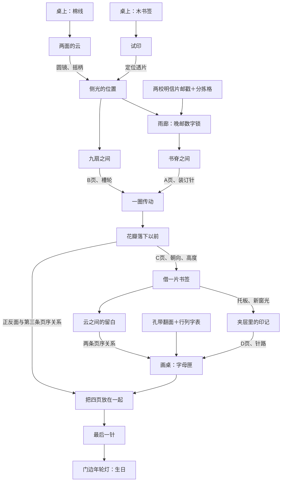

# 机关与探索

主线围绕四张画页与一本尚未装订的画册。故事是可以翻看的附页；所有规则、位置关系、正反面与机关状态都在游戏中给出，不依靠记住私人经历或角色冷知识通关。

## 依赖

迷宫、天平、音乐盒、木拼框、互锁抽屉、翻片盒是六个独立机关，不连接终点门槛。

## 主要约束

| 机关 | 思考与操作 | 回馈 |
| --- | --- | --- |
| 往返校样 | 从示例推导翻面、循环位移、交换的组合顺序 | 透片；之后回访使用逆变换 |
| 两面的云 | 三个联动轮同时满足两面窗口，不能逐窗独立设置 | 圆镜与摇柄 |
| 侧光 | 观察尺、镜、罩上的刻印，拖转三个实物旋钮，让投影清楚 | 开放邮匣和折屏两条路线 |
| 数字邮匣 | 两张明信片四枚邮戳，先镜读反印，再查分拣格，依锁上顺序读四位数 | 拉锁扣确认，开放借阅书架；错误不清输入 |
| 书脊 | 五本书与四组位置关系 | A页与针 |
| 九扇折屏 | 9个二状态端口，全程接缝同高 | B页与槽轮 |
| 穿线传动 | 路线约束、方向与步进档位同时成立 | 放映机启动 |
| 胶片 | 花瓣先后→按时间执行翻页/跟随→终态，动作不能同时计算 | C页、孔数高度、第三条页序关系 |
| 花架 | 成对抬升、循环高度与暂时固定，改变奇偶约束 | 托板；原场景出现第二层用途 |
| 逆校样 | 根据结果逆推五枚印章的初始排列 | D页和针路 |
| 云景留白 | 拉动三条透片，负形投影同时对照三枚标记；与初次云景的转轮操作不同 | 四页顺序 |
| 字母匣 | 孔带剪口与序号对齐，下带翻正，列带与行带配对查字表 | 输入五字母并回车，得到画册夹层 |
| 排页 | 合并云景两条关系与胶片一条关系，朝向跟着页而非槽位 | 待装订画册 |
| 装订 | 正反面交替的8孔连续路径 | 画册，点亮结尾 |

约束型主线有唯一合法解。迷宫允许两种等价朝向；天平允许左右互换；木框要求形状铺满且固定图案接合，不能把两块T形只因轮廓相同就互换。见 `tests/puzzles.test.mjs` 的枚举与见证路径。

## 六个独立机关

| 机关 | 必须观察的关系 | 直接操作与反馈 |
| --- | --- | --- |
| 三圈迷宫 | 通路经过两颗固定星，再到内圈出口 | 旋转三圈，轨道及时改变，合法朝向可等价 |
| 小天平 | 从四个图例推出相对重量，每边两枚 | 拖入两只盘子或点选换边，摆件与天平回应 |
| 四格抽屉 | 开闭互锁，需要中途重新打开/关闭 | 点真实抽屉区域，可转到背板观察互锁；拉不动时轻震，返回前面继续操作 |
| 翻花 | 十字邻域联动，同一格翻两次抵消 | 悬停或聚焦先显示受影响邻格；点击整片后邻格一起变面 |
| 木拼框 | 轮廓约束与画面约束必须同时满足 | 拖放、R旋转、有效/无效落点、Esc取消、重新拿起或取回；一次落位一次撤销 |
| 音乐盒 | 六个音钉之间的相对高度，不要求认谱听音 | 拖音钉或逐格升降，可试听与看对应音钉亮起 |

## 角色与物件的用途

魈/流浪者的书签跟着书移动，是排序关系的锚点；九位柱进入折屏，翻面改变接缝；小黑、无限、鹿野进入有环境的胶片，花瓣与纸背动作承担推理；小王子完整画面成为拼图。带土/卡卡西进入创作角的画稿，两个独立柱角色亚克力砖作为真实收集物件。其中刻尺、镜读、邮戳、分拣格、孔带和胶片页边规则是游戏虚构，不是私人礼物本来就有的机关。

木书签用于取出纸盒、测距、固定花架与帮助装订；棉线用于云景牵引、轮组与缝页；圆镜用于背标与夹层；透片用于照光和云景留白；摇柄用于轮组、花架与灯座。各用途有场景对应，不消耗、不依赖随机试错。

两校折页以武汉大学老斋舍、南京大学北大楼的公开实景为建筑依据，只保留建筑名与视觉细节。不会把“去过南京”变成“去过南大”，不编校史、学校关系或共同路线。邮戳放在折页的纸边，是虚构机关线索，不是校园现实编号。

回忆只保留一句锚点。回忆页和小记自愿翻看。九项小记完成且看过生日页后出现彩蛋，任何小记都不会堵住主线。

## 引导层次

默认只留一两句短说明。操作可见：拖动物件、旋转按钮、接缝端点、正反面标记。规则线索在物件和同源记录中给出，手账保留关键关系；具体步骤只在自选提示的后两层展开。画面精简不等于隐藏点击区、要求猜开发者的意图或删掉必要前提。

## 反卡关设计

- 开场两件工具明确可见，拾取热区优先于后方台灯和稿盒，避免遮挡。
- 工具不损耗。已有工具自动摆到机关旁，不要求一遍遍拖拽尝试。
- 前置不足时显示能继续探索的对象；完成记录会明确指向新可用的地方。
- 操作可撤销、可复位；完成的机关保留结果，手账保留线索。错误穿线和满孔失败仍可退回。
- 提示按“观察方向→关键关系→具体操作”三层打开，最后一层提供可执行解法。
- 不使用反应速度、长时间等待、听力或颜色差异作为唯一门槛；所有音乐盒线索均可视。
- 回忆和IP角色增加辨识与情绪，不构成需要联网搜索的知识锁。

## 试玩检查

先做不看攻略的PC试玩，记录真正停住的地点、是否误解操作与提示是否能解除卡点，再调整难度。自动通关只证明机制与依赖可走通，不等于已经证明与某一商业作品的玩家难度相同。

## 密码证据（实现核对）

数字锁：桥D1、树A4、雨B3、窗C2分别查分拣格，按锁面“桥、树、雨、窗”的次序得到1029，回应生日。南京片的反印可用圆镜照正。全部信息均可回看，不要求凭私人日期或校园常识猜答案。

字母锁：托板背面的列带为1、3、4、3、3，透片背面的行带翻正后为3、5、5、5、5。按Ⅰ到Ⅴ配对查询5×5字表，得到LXYXX：名字缩写与罗马数字20。两件旧工具再次提供线索，检查后分开记入手账；不要求猜缩写或懂罗马数字才能解锁。键入、选格、纠错、退格和回车走同一纯规则。

这两只锁都不在拨到正确值时自动开门，必须拉扣或回车。失败只产生回弹/轻响，允许继续修改；完成后冻结，不能重复发奖。
