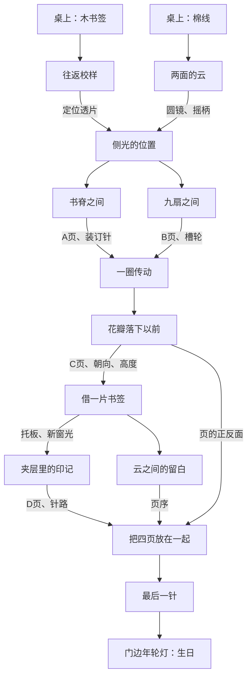

# 机关与探索

主线围绕四张画页与一本尚未装订的画册。故事是可以翻看的附页；所有规则、位置关系、正反面与机关状态都在游戏中给出，不依靠记住私人经历或角色冷知识通关。

## 依赖

迷宫、天平、音乐盒、木拼框、互锁抽屉、翻片盒是六个独立机关，不连接终点门槛。

## 主要约束

| 机关 | 思考与操作 | 回馈 |
| --- | --- | --- |
| 往返校样 | 从示例推导翻面、循环位移、交换的组合顺序 | 透片；之后回访使用逆变换 |
| 两面的云 | 三个联动轮同时满足两面窗口，不能逐窗独立设置 | 圆镜与摇柄 |
| 侧光 | 用刻尺、镜向、光罩定位 | 同时开放书架和折屏两条路线 |
| 书脊 | 五本书与四组位置关系 | A页与针 |
| 九扇折屏 | 9个二状态端口，全程接缝同高 | B页与槽轮 |
| 穿线传动 | 路线约束、方向与步进档位同时成立 | 放映机启动 |
| 胶片 | 花瓣运动的先后与四页朝向 | C页和花架高度 |
| 花架 | 成对抬升、循环高度与暂时固定，改变奇偶约束 | 托板；原场景出现第二层用途 |
| 逆校样 | 根据结果逆推五枚印章的初始排列 | D页和针路 |
| 云景留白 | 使用原联动规则的另一种窗口约束 | 四页顺序 |
| 排页 | 页序与朝向独立，朝向跟着页而非槽位 | 待装订画册 |
| 装订 | 正反面交替的8孔连续路径 | 画册，点亮结尾 |

约束型主线有唯一合法解。迷宫允许两种等价朝向；天平允许左右互换；木框接受所有合法铺满，不限制为一个预设答案。见 `tests/puzzles.test.mjs` 的枚举与见证路径。

## 反卡关设计

- 开场两件工具明确可见，拾取热区优先于后方台灯和稿盒，避免遮挡。
- 工具不损耗。已有工具自动摆到机关旁，不要求一遍遍拖拽尝试。
- 前置不足时显示能继续探索的对象；完成记录会明确指向新可用的地方。
- 操作可撤销、可复位；完成的机关保留结果，手账保留线索。错误穿线和满孔失败仍可退回。
- 提示按“观察方向→关键关系→具体操作”三层打开，最后一层提供可执行解法。
- 不使用反应速度、长时间等待、听力或颜色差异作为唯一门槛；所有音乐盒线索均可视。
- 回忆和IP角色增加辨识与情绪，不构成需要联网搜索的知识锁。

## 试玩检查

先做不看攻略的PC试玩，记录真正停住的地点、是否误解操作与提示是否能解除卡点，再调整难度。自动通关只证明机制与依赖可走通，不等于已经证明与某一商业作品的玩家难度相同。
