# V2.9 现有关系图与道具审查底稿

由 `node tools/relations.mjs` 从当前数据生成。它描述已实现的依赖，不是改造后的设计承诺；每个项目修改关系后重新生成。场景准入和工具放置仍由core校验，不以此文档驱动游戏。

## 主线与汇合

```mermaid
flowchart LR
  paper["试印"]
  cloud["两面的云"]
  calibration["借点光"]
  postbox["晚邮"]
  books["书脊之间"]
  screen["纸屏"]
  belt["穿线"]
  film["三格胶片"]
  flowers["挪挪花盆"]
  paperBack["纸盒夹层"]
  cloudGap["云之间的留白"]
  wordlock["字间"]
  album["四张画页"]
  stitch["最后一针"]
  chocolate["留一颗星"]
  cocoa["分一半"]
  sweets["二十颗糖"]
  ribbons["理理缎带"]
  birthdayLock["生日匣"]
  paper --> calibration
  cloud --> calibration
  calibration --> postbox
  postbox --> books
  calibration --> screen
  books --> belt
  screen --> belt
  belt --> film
  film --> flowers
  flowers --> paperBack
  flowers --> cloudGap
  paperBack --> wordlock
  cloudGap --> wordlock
  wordlock --> album
  film --> album
  album --> stitch
  stitch --> chocolate
  chocolate --> cocoa
  stitch --> sweets
  stitch --> ribbons
  ribbons --> birthdayLock
  postbox -->|实际拾取| borrowSlip["借阅签"]
  borrowSlip -->|准入| books
  stitch --> birthdayDoor["摇柄装入生日门"]
  birthdayDoor --> chocolate
  birthdayDoor --> sweets
  birthdayDoor --> ribbons
  sweets --> birthdayLock
  cocoa --> candles["点烛与许愿"]
  sweets --> candles
  birthdayLock --> candles
```

## 每个机关

“完成得到”列记录解开后可领取的物件；实际点击拾取后才进入库存。晚邮的借阅签留在匣内，拿走才满足书架准入；书架内如何更自然地用签，仍按P7独立审查。

| 机关 | 所在场景 | 前置机关 | 所需物品 | 完成得到 | 类型 |
| --- | --- | --- | --- | --- | --- |
| 试印 | 书桌 | — | 木书签 | 透片 | 主线 |
| 两面的云 | 窗边 | — | 棉线 | 小圆镜、摇柄 | 主线 |
| 借点光 | 书桌 | 试印、两面的云 | 木书签、透片、小圆镜 | — | 主线 |
| 晚邮 | 雨廊 | 借点光 | 小圆镜 | 借阅签 | 主线 |
| 书脊之间 | 书桌 | 晚邮 | 透片、借阅签 | 画页 A、装订针 | 主线 |
| 纸屏 | 收藏柜 | 借点光 | 摇柄 | 画页 B、槽轮 | 主线 |
| 穿线 | 书桌 | 书脊之间、纸屏 | 棉线、装订针、槽轮、摇柄 | — | 主线 |
| 三格胶片 | 书桌 | 穿线 | 透片、小圆镜 | 画页 C | 主线 |
| 挪挪花盆 | 窗边 | 三格胶片 | 木书签、摇柄 | 装订托板 | 主线 |
| 纸盒夹层 | 书桌 | 挪挪花盆 | 小圆镜 | 画页 D | 主线 |
| 云之间的留白 | 窗边 | 挪挪花盆 | 透片 | — | 主线 |
| 字间 | 画桌 | 纸盒夹层、云之间的留白 | 透片、装订托板 | — | 主线 |
| 四张画页 | 书桌 | 字间、三格胶片 | 装订托板 | — | 主线 |
| 最后一针 | 书桌 | 四张画页 | 棉线、装订针、木书签 | — | 主线 |
| 留一颗星 | 生日桌 | 最后一针 | 透片 | — | 主线 |
| 分一半 | 生日桌 | 留一颗星 | — | — | 主线 |
| 二十颗糖 | 准备台 | 最后一针 | — | 贺卡 | 主线 |
| 理理缎带 | 准备台 | 最后一针 | — | 孔带 | 主线 |
| 生日匣 | 准备台 | 理理缎带 | — | — | 主线 |
| 九月的夹页 | 书桌 | — | — | — | 独立 |
| 小迷宫 | 收藏柜 | — | — | — | 独立 |
| 小天平 | 收藏柜 | — | — | — | 独立 |
| 四格抽屉 | 门边 | — | — | — | 独立 |
| 翻花 | 门边 | — | — | — | 独立 |
| 拼木片 | 门边 | — | — | — | 独立 |
| 音乐盒 | 收藏柜 | — | — | — | 独立 |

## 重复使用

| 物品 | 数据要求它的机关 |
| --- | --- |
| 木书签 | 试印、借点光、挪挪花盆、最后一针 |
| 棉线 | 两面的云、穿线、最后一针 |
| 透片 | 借点光、书脊之间、三格胶片、云之间的留白、字间、留一颗星 |
| 小圆镜 | 借点光、晚邮、三格胶片、纸盒夹层 |
| 借阅签 | 书脊之间 |
| 摇柄 | 纸屏、穿线、挪挪花盆 |
| 装订针 | 穿线、最后一针 |
| 槽轮 | 穿线 |
| 装订托板 | 字间、四张画页 |

独立放置：摇柄 → birthday-door（最后一针以后）。机关内嵌合：贺卡、孔带、小圆镜 → 生日匣；透片、小圆镜、木书签 → 借点光。

## 逐关要继续追问的地方

上表“所需”包含准入检查，不能据此声称每件物品都已有完整抓取、操作或材料反馈。目前明确的直接复用包括试印夹扣、云景牵线、借光三工具嵌合与回收、花架书签、透片覆巧克力、摇柄装门，以及贺卡／纸带／镜子嵌入生日匣。其余关系按P3—P28逐关检查，必要时把仅检查拥有的条件改为可见且合理的操作，或删去不必要条件。

试印与云景可并行；借点光以后，书架与纸屏两支汇入穿线。花架后，纸盒夹层与云间留白两支汇入字间。生日桌与准备台两支汇入许愿。七个独立机关不进入结尾门槛；可选活动和收集物由真实状态派生成就，不维护第二套通关表。

未来改动须同时复核：证据在哪里出现、跨支线是否可能缺物、回访是否有新意义、可否撤销/取消、旧档已完成节点是否仍合法、近远景是否一致。关系多不等于玩法深，避免为了复用而把同一动作重复塞入不同关卡。
